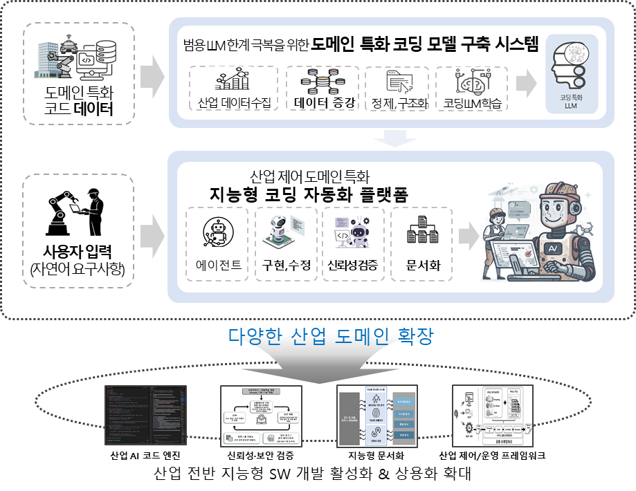

# 🏭 산업 제어 소프트웨어 특화 지능형 코드 자동 생성 연구
**Intelligent Code Generation for Industrial Control Software**

> 본 저장소는 국가 핵심 산업의 기반인 산업 제어 소프트웨어의 지능형 자동화를 실현하기 위한 **도메인 특화 코딩 LLM 및 지능형 코딩 자동화 플랫폼** 개발 연구의 메인 통합 저장소입니다.

 

## 📖 과제 개요 및 해결하고자 하는 문제

현재의 AI 코딩 모델은 공개 코드 중심으로 학습되어 일반적인 프로그래밍에는 뛰어나지만, **산업용 제어 코드**와 같은 도메인 특화 환경에서는 다음과 같은 한계가 있습니다.
* **데이터의 희소성:** 기업 내부 시스템 종속으로 인한 공개 데이터 부족
* **신뢰성 요구:** 오류 발생 시 안전·운영에 치명적이므로 높은 수준의 코드 품질과 검증 필수
* **개발 환경 제약:** 특수 개발 환경 사용으로 범용 코드 어시스턴트(예: Cursor 등) 활용 불가

본 과제는 이러한 한계를 극복하고 현장의 실질적 문제 해결과 미래 수요를 반영한 도전적 원천기술 확보를 목표로 합니다.

### 💡 개념도 (AS-IS vs TO-BE)

*(범용 LLM의 한계를 극복하고 도메인 맞춤형 코드를 생성하는 지능형 코딩 플랫폼 개념도)* 

* **AS-IS:** 범용 LLM의 산업 특화 코드 생성 한계, 도메인 전문가 의존 수작업, 복잡한 코드 이해 어려움
* **TO-BE:** 도메인 반영 산업 맞춤형 코드 생성, AI 기반 자동 코드 생성/보조, 코드 구조 분석 및 설명 자동화

**최종 결과물:**
1. 도메인 특화 코딩 모델 구축 시스템 (SW)
2. 산업 제어 도메인 특화 지능형 코딩 자동화 플랫폼 (SW)

 

## ✨ 주요 기능 (Main Features)

1. **산업 제어 코드 데이터 구축**
   * 산업 제어 코드 데이터의 수집·정제·증강 및 관리 기술
2. **도메인 지식 내재화 코드 생성 에이전트 기술**
   * 프로젝트 수준 코드 생성 및 자동 개선 기술, 산업 특성 반영 최적화
3. **코드 신뢰성 및 품질 확보 기술**
   * 테스트 시나리오 자동 생성 및 적합성 검증
   * 보안 규칙 준수 및 취약점 자동 탐지 기능
4. **코드 또는 모델 기반 문서 자동화 기술**
   * 의미 해석 기반 문서 자동 생성 및 코드-문서 일치도/영향도 분석
5. **산업 연계 지원 서비스 프레임워크 기술**
   * 코드 생성 서비스 모듈화, RAG 기반 통합 서비스 워크플로우 구성

 

## 🤝 공동연구기관 및 역할 (Architecture)

본 연구는 AI, 소프트웨어공학(SE), 프로그래밍언어(PL) 전문가들이 융합하여 세계적 수준의 지능형 SW 개발 자동화 프레임워크를 개발합니다.

*(각 기관별 산업 도메인 데이터 구축, 지능형 모듈 개발, 서비스 연동 인프라 아키텍처)* 

| 기관 | 구분 | 주요 연구 역할 |
| :--- | :---: | :--- |
| **ETRI** | **주관** | **총괄 / 특화 데이터 및 LLM:** 기술 융합 시도 및 소스코드 구조 수준 연구, 통합 프레임워크 구축. 데이터 확보/증강 및 도메인 특화 LLM 개발 |
| **서울대학교** | 공동 | **프로젝트 수준 코드 생성:** 기존 소스코드 분석을 통한 딥러닝 기반 모듈 수준 코드 생성 및 의미/컨텍스트 기반 지능형 프롬프팅 |
| **한양대학교** | 공동 | **조건부 코드 생성/분석:** 프로그램 합성 기술 활용 딥러닝 대체 불가 알고리즘 생성, 제약 기반 디코딩 및 완전성 확보 |
| **KAIST** | 공동 | **코드 신뢰성 검증:** 고신뢰성 확보를 위한 에이전트 기반 자연어-시험코드 생성 및 검증 시나리오 증강 |
| **성균관대학교**| 공동 | **코드 보안성 검증:** 안전성/보안성 보장 자동 생성 기술, 시뮬레이션 기반 테스트베드 및 자동 패칭 탐지 |
| **슈어소프트테크**| 공동 | **문서화/실증/사업화:** 에이전틱 바이브 코딩 기반 고도화, 멀티모달 문서 생성, 산업 실증(로봇/자동차 제어) 및 제품 상용화 |

 

## 📂 기관별 오픈소스 저장소 (Sub-Repositories)

공통 프레임워크는 오픈소스로 공개되며, 사내 특화 서비스는 분리되어 관리됩니다. 아래 저장소들은 본 프로젝트의 Submodule로 연결되어 있습니다.

* 🏢 **[ETRI]** `etri-domain-llm-core` : 산업 특화 코드 생성 LLM 및 데이터 파이프라인
* 🎓 **[서울대학교]** `snu-project-codegen` : 딥러닝 기반 프로젝트 수준 코드 생성 엔진
* 🎓 **[한양대학교]** `hanyang-constraint-decoder` : 조건부 제약 기반 코드 완전성 검증 모듈
* 🎓 **[KAIST]** `kaist-test-agent` : 신뢰성 검증용 시험 시나리오 자동 생성 에이전트
* 🎓 **[성균관대학교]** `skku-security-patcher` : 취약점 자동 탐지 및 보안 검증 시뮬레이터
* 🏢 **[슈어소프트테크]** `suresoft-doc-automation` : 코드-문서 정합성 분석 및 자동화 실증 통합 앱

*(※ 클론 시 `--recurse-submodules` 옵션을 사용하여 하위 저장소를 함께 받아주세요.)*

 

## 🎯 핵심 기술 및 성과

